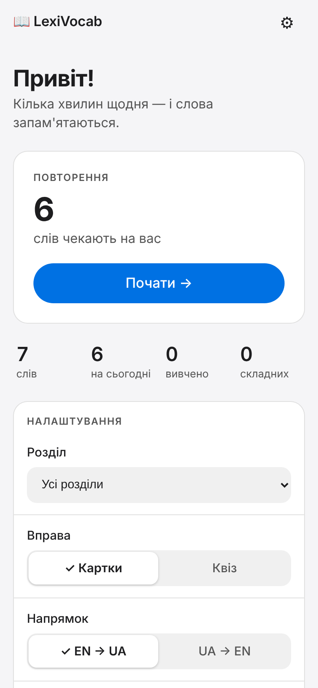

# Glossa

Особистий **англо-український словник**: вводите слово — ШІ (за замовчуванням безкоштовний Google Gemini) сам перекладає його, виправляє форму й розкладає за темами. Повторення (інтервальне, SM-2) — другорядна функція поруч зі словником. Є PWA для iPhone та віддалений MCP-сервер, через який Claude може зберігати слова просто з розмови. Вхід за особистими акаунтами (Supabase Auth: email + пароль і Google), доступ лише за запрошенням; кожен має свій словник і свій конектор Claude.

Один Python-процес на Render (безкоштовно) + Postgres на Supabase (безкоштовно):

| Шлях | Що це |
|---|---|
| `/` | PWA на React (словник із темами, додавання слова, картки й квіз, озвучення en-US), збірка `web/dist` |
| `/api/...` | REST API для PWA (токен Supabase Auth у `Authorization: Bearer`) |
| `/mcp` | MCP-сервер (streamable HTTP) + OAuth 2.1/PKCE/DCR; метадані в `/.well-known/...` |
| `/health` | `{"status":"ok"}` (робить `SELECT 1`) — для пінгера |

<p align="center"></p>

Проєкт адаптовано з vocabulary-mcp (китайська версія): збережено SM-2, окремі розклади для напрямків EN→UA та UA→EN, OAuth-провайдер; бекенд, MCP і статика об'єднані в один сервіс, SQLite замінено на Postgres.

## Розгортання крок за кроком

### 1. База даних (Supabase)
1. [supabase.com](https://supabase.com) → **New project** (free), запам'ятайте пароль БД.
2. Натисніть **Connect** → вкладка **Connection string** → тип **Session pooler** (IPv4, порт 5432). Скопіюйте рядок і підставте пароль:
   `postgresql://postgres.<ref>:<ПАРОЛЬ>@aws-0-<регіон>.pooler.supabase.com:5432/postgres?sslmode=require`
   Спецсимволи в паролі кодуйте (`@` → `%40`). Прямий хост (`db.<ref>.supabase.co`) не підходить: Render не має IPv6.
3. Таблиці створюються самі при старті сервісу.

### 2. GitHub
```bash
cd lexivocab
git remote add origin git@github.com:<you>/lexivocab.git   # порожній (можна приватний) репозиторій
git push -u origin main
```

### 3. Render (Blueprint)
1. [render.com](https://render.com) → **New → Blueprint** → оберіть репозиторій. Render прочитає `render.yaml` (free web service).
2. Введіть змінні (див. таблицю нижче): `DATABASE_URL`, `MCP_SECRET` (`openssl rand -hex 32`), `SUPABASE_URL`, `ALLOWED_EMAILS`, `OWNER_EMAIL`, `VITE_SUPABASE_URL`, `VITE_SUPABASE_ANON_KEY` (налаштування акаунтів: [docs/superpowers/plans/2026-11-04-multi-user-auth-report.md](docs/superpowers/plans/2026-11-04-multi-user-auth-report.md)), за бажанням `LLM_API_KEY` (безкоштовний ключ Gemini: [aistudio.google.com](https://aistudio.google.com) → **Get API key**). `ISSUER_URL` поки залиште будь-яким `https://...`.
3. Після першого деплою скопіюйте URL сервісу (`https://lexivocab-xxxx.onrender.com`), встановіть його в **Environment → `ISSUER_URL`** (без `/` в кінці) і натисніть **Manual Deploy → Deploy latest commit**.
4. Перевірка: `curl https://<url>/health` → `{"status":"ok"}`.

### 4. Підключення до claude.ai
**Settings → Connectors → Add custom connector** → URL: `ISSUER_URL` + `/mcp`, наприклад `https://lexivocab-xxxx.onrender.com/mcp`. Відкриється сторінка Glossa: увійдіть у свій акаунт і натисніть «Дозволити» — слова потраплять у ваш словник. Далі скажіть Claude: «збережи ці слова в Glossa».

### 5. Пінг, щоб сервіс не засинав
Безкоштовний Render засинає через 15 хв без трафіку (холодний старт ~1 хв). На [cron-job.org](https://cron-job.org): новий cron, URL `https://<url>/health`, кожні **10 хвилин**. Один сервіс 24/7 вкладається в ~750 безкоштовних годин. `/health` торкається БД, тож заодно Supabase не «призупиняє» проєкт за неактивність.

### 6. PWA на iPhone
Відкрийте `https://<url>/` у **Safari** → **Поділитися** → **На екран «Додому»** → **Додати**. Створіть акаунт або увійдіть (email вже має бути в `ALLOWED_EMAILS`).

## Як додається слово
Головний екран — словник. Введіть англійське слово (у будь-якій формі, навіть з помилкою) і натисніть «Додати»:
- ШІ **нормалізує** слово до словникової форми (`ran` → `run`), перекладає його українською за частинами мови, обирає головне значення й **тему**;
- якщо слово вже є, воно не дублюється — показується наявний запис, який можна змінити;
- якщо введено не англійське слово, нічого не зберігається;
- якщо переклад недоступний (немає ключа чи збій), введіть переклад вручну — слово потрапить у тему «Без теми».

Теми показані плитками на головному екрані; тема відкривається окремою сторінкою зі списком слів, пошуком, перейменуванням (перейменування на наявну тему об'єднує їх) і кнопкою «Повторити тему». У меню «⋯» є «Розкласти слова без теми» — ШІ розкладає такі слова за темами порціями. Кнопка «Повторити» відкриває вибір тем (можна кілька), режим (картки чи квіз) і напрямок.

## Змінні середовища

| Змінна | Обов'язкова | Опис |
|---|---|---|
| `DATABASE_URL` | так | Рядок Postgres (Supabase Session pooler, `?sslmode=require`) |
| `MCP_SECRET` | так | Ключ підпису токенів MCP-конектора (довгий випадковий рядок; його ніхто не вводить) |
| `SUPABASE_URL` | так | `https://<project>.supabase.co`: звідси беруться ключі перевірки токенів входу |
| `ALLOWED_EMAILS` | так | Email-и через кому, яким дозволено користуватись (без урахування регістру); решта бачить «Немає доступу» |
| `OWNER_EMAIL` | ні | Слова, збережені до появи акаунтів, перейдуть до цієї людини при першому вході |
| `SUPABASE_JWT_SECRET` | ні | HS256-секрет для старих проєктів Supabase; нові проєкти підписують ключем ES256 і цього не потребують |
| `VITE_SUPABASE_URL`, `VITE_SUPABASE_ANON_KEY` | так (збірка) | Публічні значення для вебзастосунку (читає Vite під час збірки; anon-ключ публічний за задумом) |
| `ISSUER_URL` | так (для MCP) | Публічний **https** URL сервісу без `/` в кінці |
| `LLM_API_KEY` | ні | Ключ для автоперекладу, нормалізації й тем (за замовчуванням Google Gemini, безкоштовний тариф ~15 запитів/хв). Без нього переклад вводиться вручну |
| `LLM_BASE_URL` | ні | Будь-який OpenAI-сумісний API; за замовчуванням `https://generativelanguage.googleapis.com/v1beta/openai/` (Gemini). Groq, Mistral, OpenRouter, Anthropic теж підходять |
| `LLM_MODEL` | ні | Модель, за замовчуванням `gemini-flash-lite-latest` |
| `LLM_REASONING_EFFORT` | ні | Для моделей із міркуванням, напр. `low` для `openai/gpt-oss-120b`. Швидше й менше токенів |
| `LLM_2_MODEL`, `LLM_2_API_KEY`, `LLM_2_BASE_URL`, `LLM_2_REASONING_EFFORT` (і далі `LLM_3_…` до `LLM_9_…`) | ні | Запасні LLM. Якщо основна відповіла «ліміт» (429), впала чи не відповіла за 12 с, запит іде до наступної; та, що відповіла «ліміт», пропускається, доки не мине її пауза. Без ключа чи адреси береться ключ і адреса основної (напр. інша модель на тому самому ключі Groq) |

| `PORT` | ні | Порт (Render виставляє сам; локально 8000) |
| `APP_TIMEZONE` | ні | Часовий пояс для «на сьогодні», за замовчуванням `Europe/Kyiv` |

Безкоштовна й швидка альтернатива Gemini: [Groq](https://console.groq.com) з відкритою моделлю: `LLM_BASE_URL=https://api.groq.com/openai/v1`, `LLM_MODEL=openai/gpt-oss-120b`, `LLM_REASONING_EFFORT=low`.

## MCP-інструменти
`add_words` (до 50, без дублікатів без урахування регістру), `list_words` (фільтри: розділ, лише на сьогодні, лише складні; показує ease factor, lapses, повторення для обох напрямків), `update_word`, `delete_word`, `list_sections`, `get_stats` (усього / на сьогодні / вивчено / складні).

«Складне» слово: ease factor < 2.1 або ≥ 2 помилок (lapses) в будь-якому напрямку. «Вивчене»: ≥ 3 успішних повторень поспіль (EN→UA). Оцінки в PWA: Ще раз=0, Важко=3, Добре=4, Легко=5; помилка (0) повертає картку на завтра й зменшує ease на 0.2.

## Локальний запуск і тести
```bash
python -m venv .venv && . .venv/bin/activate
pip install -r requirements-dev.txt
cp .env.example .env   # заповніть DATABASE_URL (будь-який Postgres)
uvicorn app.main:app --env-file .env --reload   # http://localhost:8000
TEST_DATABASE_URL=postgresql://... python -m pytest       # тести чистять таблиці words і oauth_* у цій БД!
BASE_URL=http://localhost:8000 python tools/smoke_test.py   # перевірка метаданих OAuth і захисту MCP
```

Фронтенд (React + Vite + TypeScript, потрібен Node 20+):
```bash
npm --prefix web ci                # один раз
uvicorn app.main:app --env-file .env --reload   # API на :8000
npm --prefix web run dev           # http://localhost:5173, запити /api йдуть на :8000
npm --prefix web run typecheck     # tsc --noEmit
npm --prefix web run build         # збірка в web/dist; її віддає FastAPI на / (Render збирає її сам)
```
Тести Python не потребують Node: статику перевіряють на мініатюрній збірці, а перевірка справжньої `web/dist` пропускається, якщо її немає.

## Структура
```
app/        main.py (збірка ASGI), api.py (REST), vocab.py (логіка + SM-2), db.py (psycopg, схема),
            mcp_tools.py (MCP-інструменти), oauth_provider.py / oauth_store.py / oauth_templates.py, auth.py
web/        React-застосунок: src/{api,routes,components,lib,styles}, public/ (іконки), vite.config.ts (PWA)
tests/      pytest (API, SM-2, повний OAuth+MCP потік)
tools/      make_icons.py, smoke_test.py
render.yaml requirements.txt .env.example
```

## Обмеження
- Безкоштовний Render без пінгера засинає; перший запит після сну ~1 хв.
- Незавершені OAuth-входи зберігаються в пам'яті: після перезапуску сервісу підключення треба почати знову (токени й клієнти — у Postgres).
- Озвучення залежить від голосів пристрою (iPhone: Налаштування › Універсальний доступ › Промовлений вміст › Голоси).
